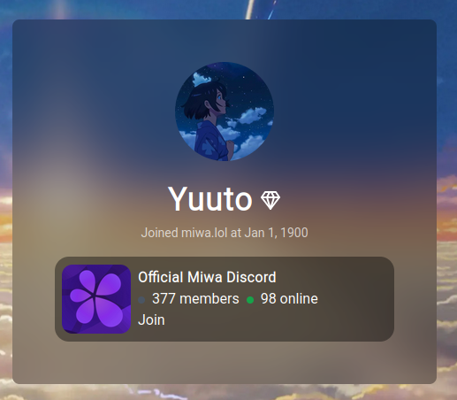
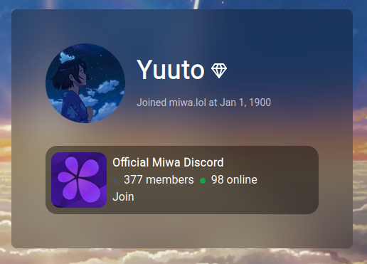

import Aside from '@/components/mdx/Aside.astro';

<Aside type="info">This is a Premium feature.</Aside>

You can customize the layout of your profile with different styles.

To change your layout, go to your [Dashboard > Customize](https://miwa.lol/dashboard/customize), then go to the *General* tab and select a style.

## Default

As its name suggests, this is the default layout.

## Modern

This layout is more modern and has a cleaner look.

## Split

Your profile card is split into two columns: your avatar, name, badges and links on the left, and your description and cards on the right. It's wider than the other layouts, which gives your cards more room.

On phones, the two columns stack on top of each other.

## Hero

There's no profile card: your avatar, name, description and links sit directly on your background, centered, with your cards underneath.

<Aside type="info">
  Because there's no card, the [profile card](/customize/profile-card/) settings for opacity, blur and border don't change how this layout looks. Your border still applies to your cards.
</Aside>