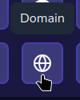

import Aside from '@/components/mdx/Aside.astro';

A custom link lets you add any URL, such as a personal website or a specific page, that isn't covered by the built-in platforms.

To add a custom link, select the *Domain* option in the list.

Then, enter the link you want to add and click *Add*. This can be any link, such as a website or a specific page.

## Custom icon

**You can give your custom link its own icon.** In the *Icon* area of the editor, drop an image or click to pick one.

If you don't upload an icon, the website's favicon is used instead.

<Aside type="info">
  The icon can only be set when you add the link. To change it later, delete the link and add it again with the new icon.
</Aside>

Like any other link, a custom link can also be made [copyable](/links/adding-a-link/#copyable-text) and given a [custom label](/links/adding-a-link/#custom-label).
