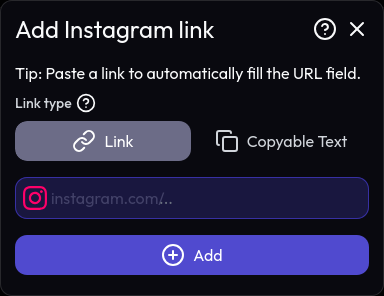

import Aside from '@/components/mdx/Aside.astro';
import { PlusCircle, Search } from 'lucide-astro';

**To add links to your profile, go to the [Links](https://miwa.lol/dashboard/links) page of the dashboard.**
Select the social media platform you want to add a link for (or type its name in the <Search /> search bar), and enter your username or profile URL.

Then, click the <PlusCircle /> **Add** button to add the link to your profile. You can add multiple links by repeating this process.

<Aside type="tip">
  For most platforms you don't have to work out which part of a URL to enter: paste the whole profile link and we'll fill the field in for you. The editor shows a tip when the platform supports it.
</Aside>

## Copyable text

By default, a link opens in a new tab when visitors click it. Turn on the **Copyable Text** switch to copy the entered text to the visitor's clipboard instead, without opening anything. This suits usernames that have no profile page.

<Aside type="info">
  Some platforms, such as crypto addresses and friend codes, are always copyable text, so the switch isn't shown for them. See the [copy-only platforms](/links/supported-platforms/#copy-only-platforms).
</Aside>

## Variants

A few platforms offer a choice above the value field:

* **X**: under *Logo*, pick whether your link shows the **X** logo or the blue **Twitter** bird.
* **Discord**: under *Links to*, pick **Server invite** to link a `discord.gg` invite, or **User profile** to link your account by its user ID (e.g. `123456789012345678`). Pasting a `discord.com/users/...` link selects *User profile* for you.

## Custom label

The **Custom label** field is optional. Its text, up to 80 characters, is shown when a visitor hovers over the link or focuses it with the keyboard. Leave it empty to keep the default.
